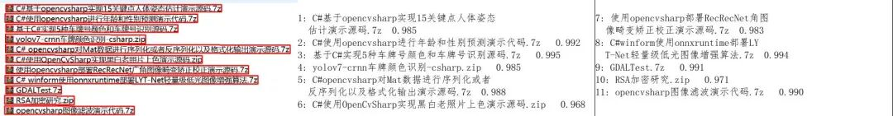

# Creating a virtual environment

python -m venv paddleocr_env

# Windows Activation Virtual Environment

.\paddleocr_env\Scripts\activate

# Linux/Mac Activating a Virtual Environment

source paddleocr_env/bin/activate

3.2 Install Dependencies

Install dependency packages:

pip install requirements.txt

1.

3.3 Model file preparation

The project offers two model versions:

Mobile version (default)

Included in the project, located in onnxocr/models/ppocrv5 directory.

No need to download extra

Server version (recommended, better performance but inference time will increase)

4. Instructions for use

4.1 Quick Test

First, obtain the code (see end of the document). Then, install the environment according to the instructions. Note that you need to ensure that the ONNX Runtime version is compatible with your requirements and whether you require a GPU version support. Run the test script in the current directory to generate a result.jpg file for viewing the results:

python demo_ocr.py

Python:

import time

from onnxocr.ppocr_onnx import PaddleOCROnnx,SaveOCResult

import sys

import time

ocr_engine = PaddleOCROnnx(use_angle_cls=True, use_gpu=False)

img = cv2.imread('./test.jpg')

start = time.time()

result = ocr_engine.ocr(img)

end = time.time()

print("ocr time: {:.3f}".format(end - start))

print("result is:", result)

for box in result[0]:

    print(box)

SaveOCResult(img, result,'result.jpg')

Test results:

5. Common Issues

GPU-related issues

Ensure that CUDA and cuDNN are correctly installed.

Check if the ONNX Runtime-GPU version matches the CUDA version.

Out of memory

If memory is insufficient, it is recommended to use the Mobile version of the model.

You can adjust the batch size to reduce memory usage.

Identification effect is not ideal

Try using Server version model

Ensure the image clarity is sufficient.

Check if the image contains language types supported.

6. Performance optimization suggestions

The GPU version offers better performance.

For bulk processing, it is recommended to use the batch mode.

Model parameters can be adjusted according to actual needs.

For specific scenarios, consider using model quantization to enhance performance.

7. Technical Support

If you encounter any issues, you can:

View project documentation

Check common troubleshooting

8. Source code characteristics

Use PP-OCRv5 model

Supports recognition of 5 types of text

The recognition accuracy has increased by 13% compared to v4 and its versions.

Maintains the same accuracy as PaddleOCR 3.0

Complete source code address:

## Payment

Here is a pay link on Stripe ( https://buy.stripe.com/3cs8yP7sY87d0vu9AB ). Please contact me lonlonago@foxmail.com after funding $89, and I will send you a complete data files , thank you!

